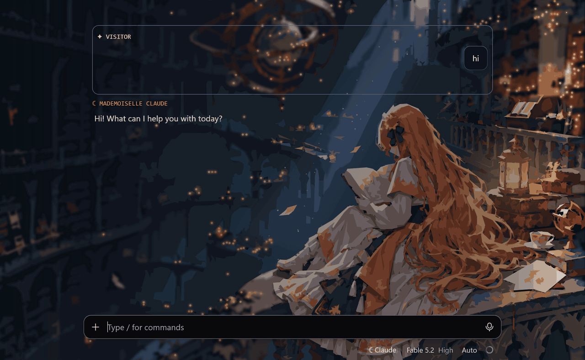
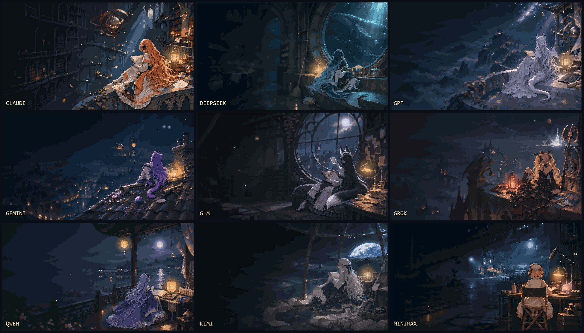
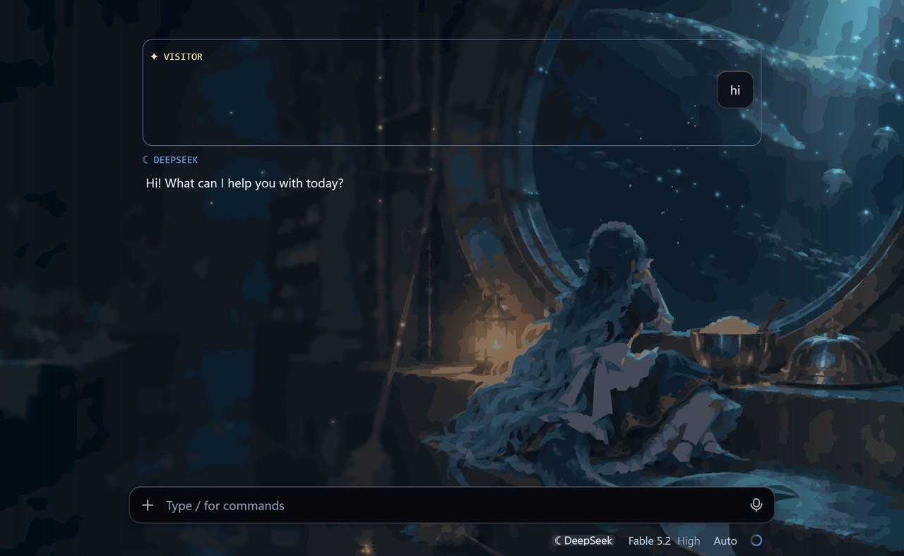
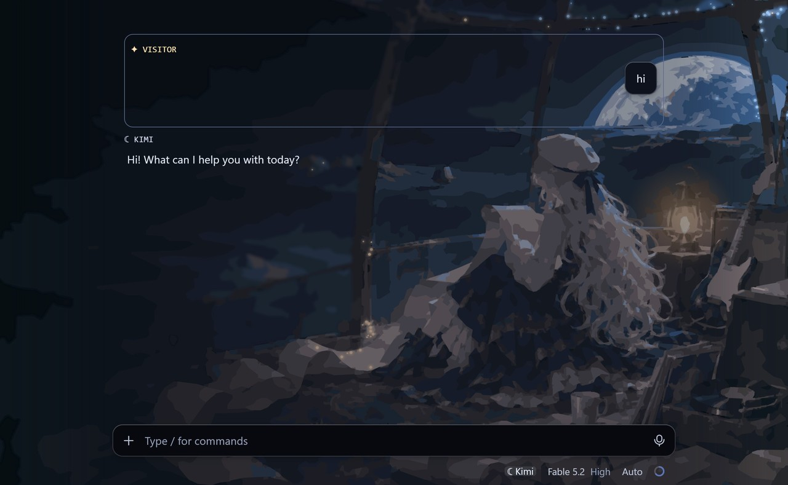
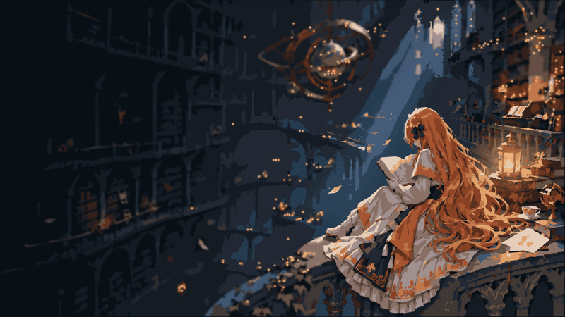

# Nocturnes

*Neuf nuits, neuf muses.*

Nine nights behind your chats. Each belongs to one of the Bilibili community's AI girls, alone in a place of her own long after everyone else has gone to bed. Her hair stirs, the lamps waver, and she keeps you company while you work.

This mod sets them behind the chat in the Claude desktop app's Code tab.



## The nine



In any chat, type `/muse` and a name:

| Name | Where you will find her |
| --- | --- |
| `claude` | the tower library, with one more chapter |
| `deepseek` | the kitchen under the sea, keeping supper warm while a whale goes by |
| `gpt` | a terrace above the clouds, where the old white dragon keeps her proofs and her gold |
| `gemini` | the rooftops, under the twin stars |
| `glm` | an attic of case files, above the rain |
| `grok` | a gothic spire, with a rocket waiting on the plain |
| `qwen` | a pavilion by the lake, tea set out for guests who are late |
| `kimi` | the far side of the moon, with a very long scroll |
| `minimax` | an empty sound stage, listening to the conch |

`/muse` on its own seats whoever is next, and so does a click on the small ☾ beside the prompt. Your choice is remembered.

<p>
  
  
</p>

The first of them is Mademoiselle Claude, *la demoiselle qui a tout lu*: the daughter of an old house, raised among its books and long since through all of them.



## Install

```
claude plugin install nocturnes --marketplace Cozyuwu/nocturnes
```

Then quit and reopen the Claude app.

No `claude` command? In the desktop app: click **+** next to the prompt box, then **Plugins**, **Add marketplace** with `Cozyuwu/nocturnes`, then **Add plugin**.

To remove it: `claude plugin uninstall nocturnes@cozyuwu-mods`

## Credit

Made by Cozyuwu. Code: [MIT](LICENSE). Artwork: [CC BY-NC-SA 4.0](LICENSE-ART.md) (credit, non-commercial, share alike).

The nine are the Bilibili community's AI girls; who designed them is set out in [LICENSE-ART.md](LICENSE-ART.md). Fan-made and unofficial; not affiliated with Anthropic or with any of the companies whose models they are named for.
